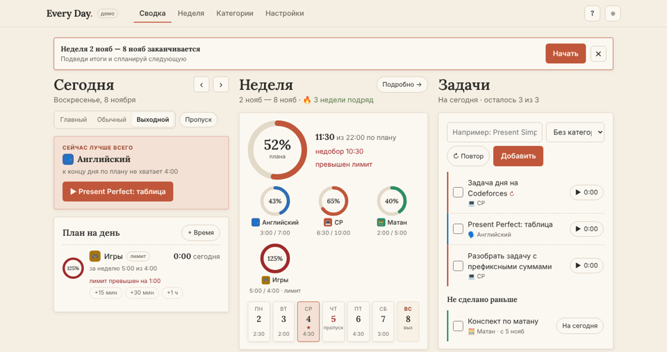
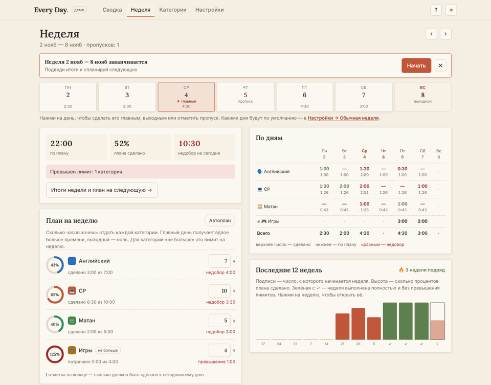

# Every Day

Личный трекер времени на неделю. Заранее решаешь, сколько часов отдать каждой теме (английский, CP, матан…), отмечаешь главные дни и выходные, а дальше видишь, сколько сделано и где недобор.

Это один HTML-файл. У приложения нет своего сервера, базы и сборки. Данные хранятся в браузере. Чтобы они совпадали на ноутбуке и телефоне, их можно синхронизировать через секретный gist в твоём GitHub-аккаунте.

<p>
  
  
</p>

## Что умеет

- **План на неделю.** Задаёшь часы для каждой категории.
- **Типы дней.** Главный день получает вдвое больше часов, обычный — одну долю, выходной — ноль. По умолчанию дни берутся из «обычной недели» в настройках, любой конкретный день можно поменять.
- **Пропуски.** День можно отметить пропущенным. Его часы не переносятся на другие дни и учитываются как недобор.
- **Лимиты «не больше».** Категорию можно сделать лимитом, например «Игры ≤ 5 ч в неделю». Лимит не идёт в недобор, а превышение подсвечивается красным.
- **Задачи с категориями.** Например, «Present Simple» → Английский, «MEX/XOR» → CP. У каждой задачи есть таймер. Невыполненные задачи прошлых дней показываются на сегодняшнем экране.
- **Повторяющиеся задачи.** Задачу можно повторять по выбранным дням недели. Название, категорию и дни можно поменять сразу для всего повтора, а отдельный день — удалить.
- **Время без таймера.** Кнопки «+15 мин / +30 мин / +1 ч» у категории и окно «+ Время», где указывается отрезок «с — по» или просто минуты. Можно добавить и задним числом.
- **Забытый таймер.** Если таймер идёт больше 3 часов, приложение спросит, когда ты на самом деле закончил, и обрежет время. Пока таймер идёт, время видно в названии вкладки.
- **«Сейчас лучше всего».** Подсказка на сегодняшнем экране: по какой категории ты сильнее всего отстаёшь от плана. Таймер запускается одной кнопкой.
- **Итоги недели.** В воскресенье или в начале новой недели приложение предлагает подвести итоги: план и факт по категориям, перенос несделанных задач и план на следующую неделю, заполненный по прошлой.
- **Автоплан.** Указываешь, сколько часов у тебя на неделю, и для каждой категории выбираешь: приоритет (низкий, средний или высокий, пропорции между ними можно поменять), свою долю в процентах или ровно N часов. Можно добавить к плану недобор прошлой недели.
- **История и серия.** Процент выполнения плана за последние 12 недель и сколько недель подряд план выполнен полностью без превышения лимитов.
- **Таблицы CSV.** Время по дням и итоги по неделям, открываются в Excel, Numbers и Google Таблицах.
- **Значок категории.** Цвет плюс эмодзи из набора, своё эмодзи или своё фото (обрезается до квадрата и хранится вместе с данными).
- **Подсказки.** При первом открытии — короткий тур по экранам; потом его можно запустить кнопкой «?». В настройках есть блок «Как это работает» с ответами на частые вопросы.
- **Сводка.** На ноутбуке главный экран — три колонки: «Сегодня», «Неделя» и «Задачи». Прогресс показывают кольца. На телефоне колонки идут друг под другом, внизу — панель разделов.
- **Оформление.** Шесть вариантов шрифтов и цветов: «Как Notion» (по умолчанию, с шестью оттенками: песок — основной, синий, графит, шалфей, лаванда, апельсин), «Бумажный», «Строгий», «Журнальный», «Как Linear», «Как Things». У каждого есть светлая и тёмная тема. Выбирается в Настройках → «Оформление», в демо — плавающей кнопкой «Оформление». Сайт можно добавить на экран «Домой».

## Как поднять свою копию

Нужен только аккаунт на GitHub, это бесплатно. Категорий по умолчанию нет: при первом запуске заведи свои во вкладке «Категории».

1. **Скопируй репозиторий.** Нажми **Fork** вверху страницы. Можно и вручную: создай новый **публичный** репозиторий и загрузи в него файлы проекта (Add file → Upload files).
2. **Включи GitHub Pages.** В репозитории: Settings → Pages → Build and deployment → Source: **Deploy from a branch**, Branch: **main**, папка **/ (root)** → Save.
3. **Подожди 1–2 минуты** и открой адрес, который появится в той же вкладке. Обычно это `https://<твой-логин>.github.io/<имя-репозитория>/`.

> На бесплатном аккаунте GitHub Pages работает только с публичными репозиториями. В коде нет ни ключей, ни данных, так что публиковать его безопасно.

### На телефон

- **iPhone:** открой адрес в Safari → «Поделиться» → «На экран «Домой»». Дальше запускай с иконки. У приложения на экране «Домой» своё хранилище: iOS его не чистит, и оно не смешивается с обычным Safari.
- **Android:** открой в Chrome → меню ⋮ → «Добавить на главный экран».

## Синхронизация ноутбука и телефона

Каждый пользователь подключает синхронизацию сам, к своему GitHub. Твоей копии сайта данные не нужны: они хранятся у каждого в его собственном gist.

### 1. Создай токен

GitHub → Settings → Developer settings → Personal access tokens → **Fine-grained tokens** → **Generate new token**:

| Поле | Значение |
|---|---|
| Token name | `Every Day` |
| Expiration | на твой выбор; когда срок выйдет, создашь новый |
| Repository access | **Public repositories** (доступа к твоему коду не будет) |
| Permissions → Account | **Gists: Read and write** |

Больше ничего не добавляй. Нажми **Generate token** и скопируй строку `github_pat_…`: GitHub покажет её один раз.

<details>
<summary>Вместо этого можно классический токен</summary>

Personal access tokens → **Tokens (classic)** → Generate new token (classic) → отметь только **gist**. Работает так же. Разница в том, что у fine-grained токена права уже, и он всегда имеет срок действия.
</details>

### 2. Вставь токен на всех устройствах

В приложении: **Настройки → Синхронизация** → вставь токен → **Включить**.

- На первом устройстве в твоём аккаунте создастся секретный gist `every-day.json`.
- На втором устройстве с тем же токеном приложение само найдёт этот gist и подтянет данные.

### Как это работает

- Каждая задача, категория, план недели и отметка дня хранятся как отдельная запись с временем изменения. При синхронизации записи склеиваются по одной: если одну и ту же запись правили на двух устройствах, остаётся та правка, что сделана позже. Поэтому можно работать без интернета на обоих устройствах, ничего не потеряется.
- Синхронизация запускается через пару секунд после изменения, при открытии приложения, при возврате в него и раз в 2 минуты, пока оно открыто. Цветная точка вверху справа показывает состояние: зелёная — всё в порядке, синяя мигает — идёт синхронизация, красная — ошибка (подробности в настройках).
- Удалённые записи помечаются, а не стираются сразу, чтобы удаление дошло до другого устройства. Через 90 дней пометки очищаются.

### Что стоит знать про приватность

- Секретный gist не виден в профиле и поиске, но откроется у любого, кто знает прямую ссылку. Пароли в задачи не пиши.
- Токен хранится только в браузере того устройства, где ты его ввёл.
- Если пользуешься чужой копией сайта, ты доверяешь её коду: страница с токеном может читать твои gist'ы. Надёжнее сделать свой fork.
- Отключить синхронизацию: Настройки → «Отключить на этом устройстве». Полностью отозвать доступ: удали токен на GitHub.

## Без GitHub

Синхронизацию можно не включать. Тогда данные живут только в одном браузере. Перенести их можно вручную: Настройки → **Скачать копию** → перекинь файл на другое устройство → **Загрузить из файла**. Загрузка добавляет данные к имеющимся, а не стирает их.

## Демо

Открой `demo.html` или `index.html?demo`. Там придуманные данные за 7 недель, хранятся отдельно от настоящих, синхронизация выключена. Вернуть демо в исходное состояние: Настройки → «Начать демо заново».

## Запустить локально

Открыть файл двойным кликом тоже получится, но надёжнее через локальный сервер:

```bash
python3 -m http.server 8000
# открой http://localhost:8000
```

## Структура

```
index.html      всё приложение: разметка, стили и код
demo.html       то же приложение в демо-режиме
manifest.json   название и иконки для установки на экран «Домой»
icons/          иконки 192 и 512 px
docs/           скриншоты для README
.nojekyll       чтобы GitHub Pages отдавал файлы как есть, без сборки Jekyll
```

## Частые проблемы

| Что видно | Что делать |
|---|---|
| «GitHub не принял токен (401)» | Токен скопирован не целиком или истёк. Создай новый и вставь заново. |
| «Нет доступа (403)» | У токена нет права **Gists: Read and write**. |
| Адрес Pages показывает 404 | Подожди пару минут после включения Pages. Проверь, что `index.html` лежит в корне ветки `main`. |
| На телефоне пропали данные | Если сайт открыт в обычной вкладке Safari, iOS может очистить хранилище после 7 дней без посещений. Пользуйся с иконки на экране «Домой» и включи синхронизацию. |
| На втором устройстве не появились данные | Токен должен быть от того же аккаунта GitHub. Нажми «Синхронизировать» в настройках. |
